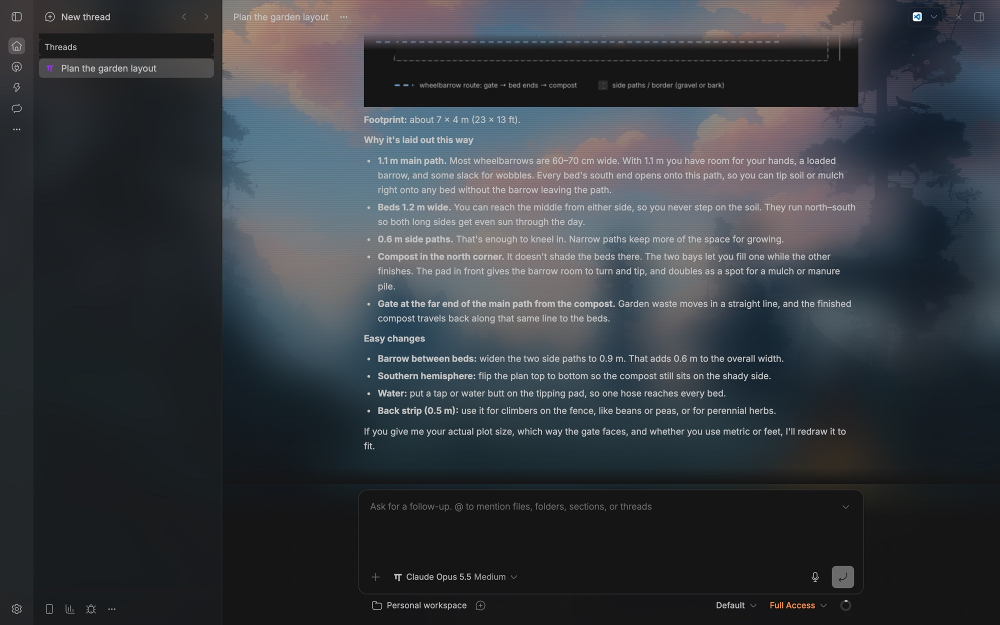
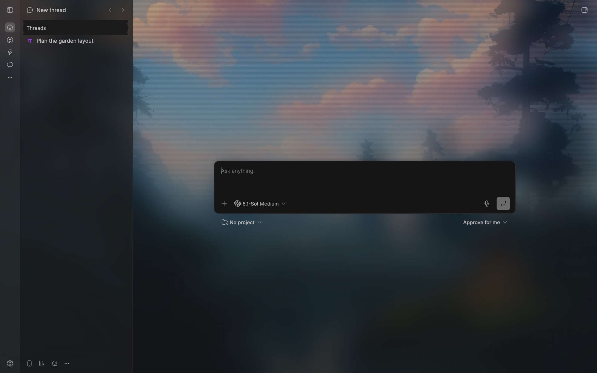
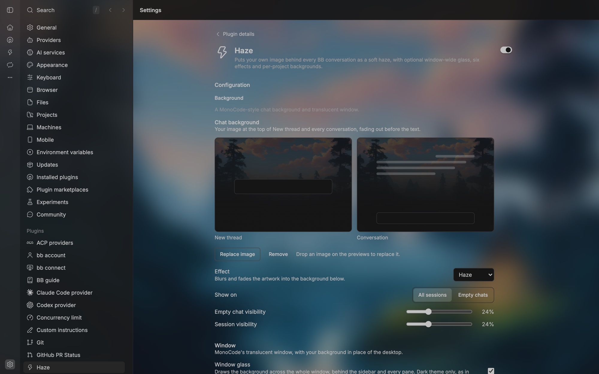

# Haze

MonoCode's chat background and translucent window for BB. Your image appears as
a soft haze at the top of New thread and every conversation and fades into the
theme colour before it reaches the text. With window glass on, the same image,
blurred, sits behind the whole window the way the desktop shows through MonoCode.



| New thread | Settings → Haze |
| --- | --- |
|  |  |

Want to try it straight away? Download the sample wallpaper
[`docs/wallpapers/scenic-valley.jpg`](docs/wallpapers/scenic-valley.jpg) (public
domain, see credits) and choose it in **Settings → Haze**.

Haze ports the look of [MonoCode](https://github.com/hardbeat920/monocode) to BB.
It was inspired by [Aura](https://github.com/MateoCerquetella/bb-plugins/tree/HEAD/plugins/aura)
and replaces it. It needs no account or network service: images stay in BB's
local plugin database.

Open **Settings → Haze** (images are resized on the client to 2560 px WebP):

- **Backdrop:** a live scene drawn behind the whole window, the BB version of a
  Claude Code mod's [backdrop](https://code.claude.com/docs/en/plugins/mods/interface#put-a-backdrop-behind-the-conversation).
  It fills the conversation from the header to the bottom edge, under the
  composer too, and replaces the chat background while it is on. The first
  scene is **Cloud Drift**: ASCII cumulus clouds drifting across a bright sky,
  with flocks of birds flapping past. **Colours** either switches BB to the
  scene's scheme while it shows (*Match scene*, like Claude Code's
  `overrideColorScheme`; Cloud Drift is a light scene) or keeps your theme.
  **Reading veil** (0–80%, default 45%) washes the reading column so text
  stays legible; **Motion** off holds a still frame. The command palette has
  *Haze: Cloud Drift backdrop* and *Haze: Turn the backdrop off*.
- **Chat background:** image, **Effect** (None, Dither, ASCII, Halftone,
  Scanlines, Haze), **Fill** (*Top haze*, MonoCode's fade at the top of the
  pane, or *Full screen*, the image behind the whole window from the header
  to below the composer, with its own **Reading veil**), **Show on** (all sessions or empty chats), and separate
  visibility for empty chats and sessions (5–65%, default 24%). These are
  MonoCode's names, ranges and defaults.
- **Window:** window glass, sidebar opacity (default 85%), blur radius (default
  24 px) and main pane glass (the workspace at 40%).
- **Project backgrounds:** a project can have its own image and settings. Panes
  in the focused project use it; other projects use the chat background.
- **Reset to defaults.**

Turn Aura off while Haze is on (`bb plugin disable aura`). Both plugins draw on the same panels.

## How it works

- `app.tsx` mounts an app overlay that writes the backdrop or the focused
  project's background to `<html>` (`data-haze-backdrop`, `data-haze`,
  `data-haze-glass` and CSS variables), and renders the settings page.
- `lib/backdrop.tsx` runs a scene on a canvas fixed behind all of BB: sizing,
  a 30 fps loop that pauses while the window is hidden, a circular reveal when
  you switch scenes, and the colour-scheme override (it holds BB's `dark`
  class and restores what BB last asked for). Scenes live in `lib/scenes/`; a
  scene is a `SceneDefinition` whose instance only resizes and draws. Add one
  there and its id to `SCENES` in `lib/model.ts`.
- `lib/effects.ts` ports MonoCode's pixel effects to a Web Worker built from
  one function, cached per image, effect and theme.
- `app.css` draws with `::before`/`::after` on BB's `#root-compose-main-panel`
  and `#thread-detail-timeline-panel`, and on `body` for the window. The pane
  image is `background-attachment: fixed`, so split panes show slices of one
  picture lined up with the window glass. Masks come from MonoCode's `src/styles/index.css`.
- `server.ts` stores the global and per-project backgrounds in SQLite and serves
  images at `/api/v1/plugins/haze/http/image?t=<target>&v=<version>`.

The CSS depends on BB's DOM: those two panel ids, `[data-sidebar=…]`,
`[data-page-scroll-viewport]`, `[data-scroll-attached]`, `[data-scroll-footer]`
(and BB's fade strip above it), the thread header, the `dark` class on
`<html>`, and, in the desktop app, the framed `group/sidebar-wrapper` that
paints the window frame. Recheck them after a BB upgrade.

## Install

```sh
bb plugin install https://github.com/AdzeB/bb-plugin-haze
```

From a checkout:

```sh
npm install --include=dev
npm run typecheck
bb plugin build . && bb plugin install . --yes
```

## License and credits

MIT, see [LICENSE](LICENSE). The pixel effects (`lib/effects.ts`), the fade
masks in `app.css`, and the effect names, ranges and defaults are adapted from
MonoCode (MIT, Copyright (c) 2026 Nick); its notice is in [NOTICE](NOTICE).
Haze is not affiliated with MonoCode.

The sample wallpaper and the screenshots' background is
[Scenic Valley in the Afternoon (SD1.5)](https://commons.wikimedia.org/wiki/File:Scenic_Valley_in_the_Afternoon_(SD1.5).jpg)
by VulcanSphere on Wikimedia Commons, released into the public domain; it is
resized here. The screenshots come from a fresh BB profile with a sample thread.
